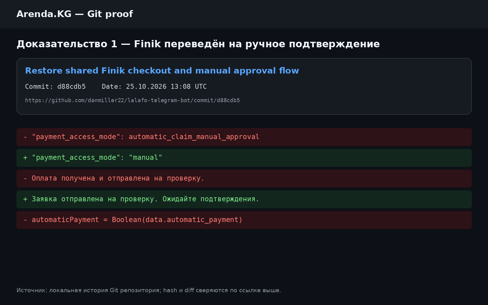
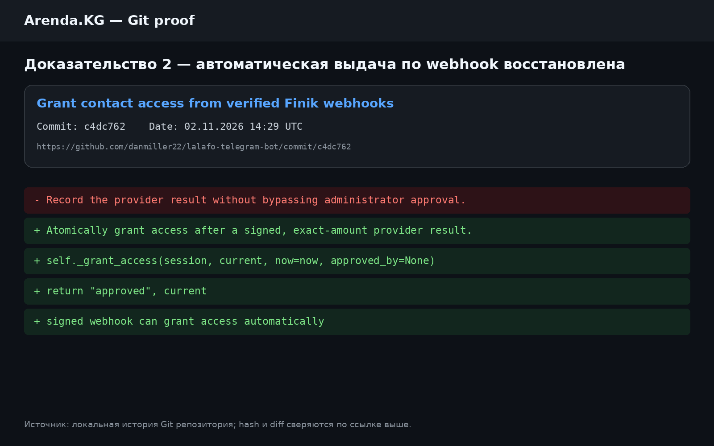
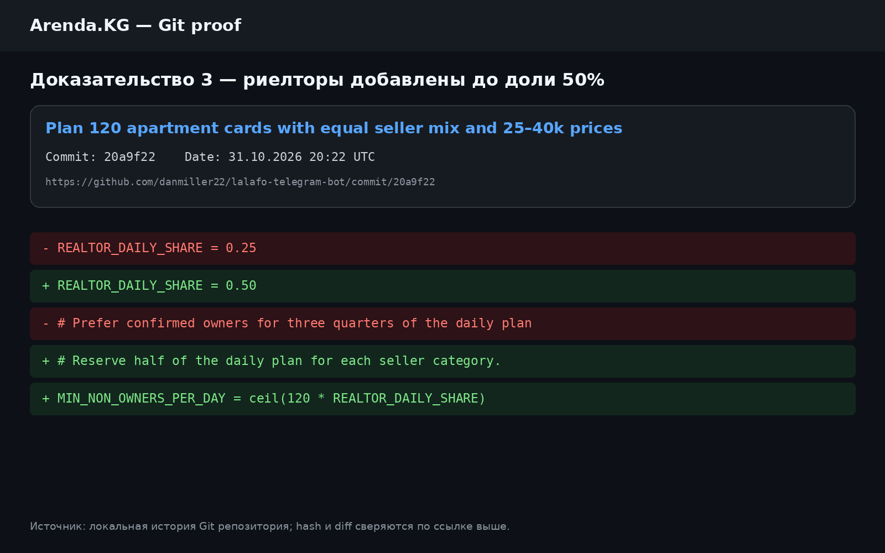
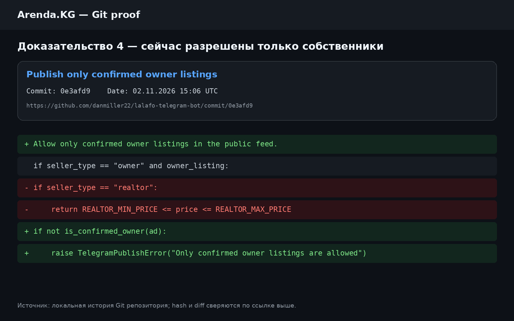
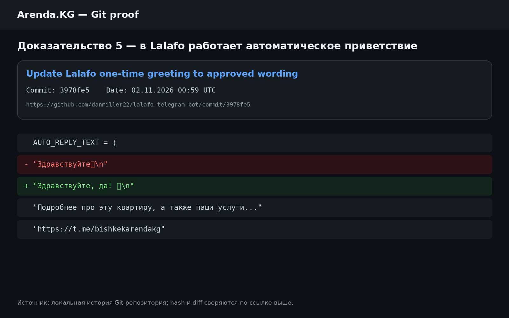
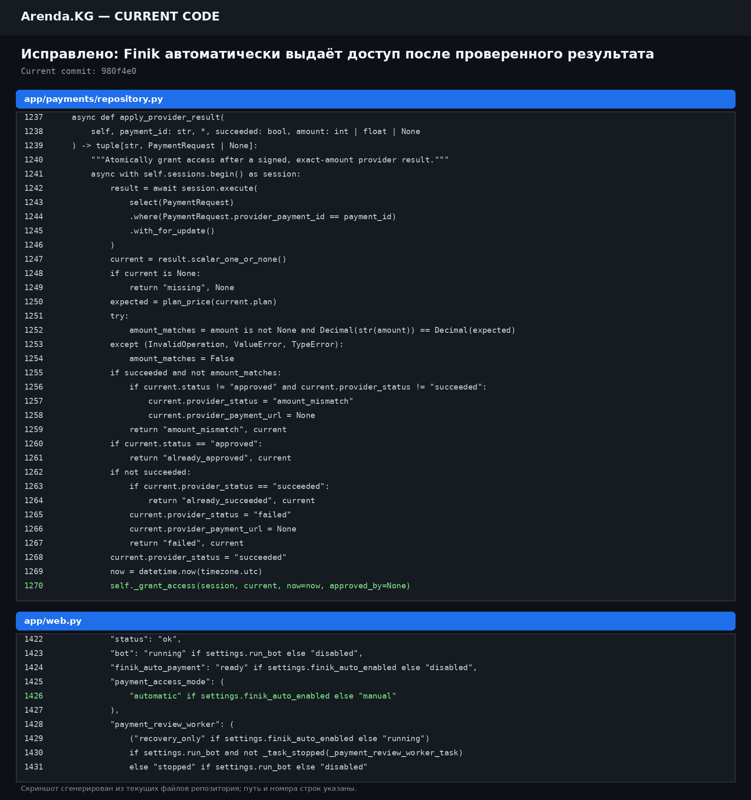
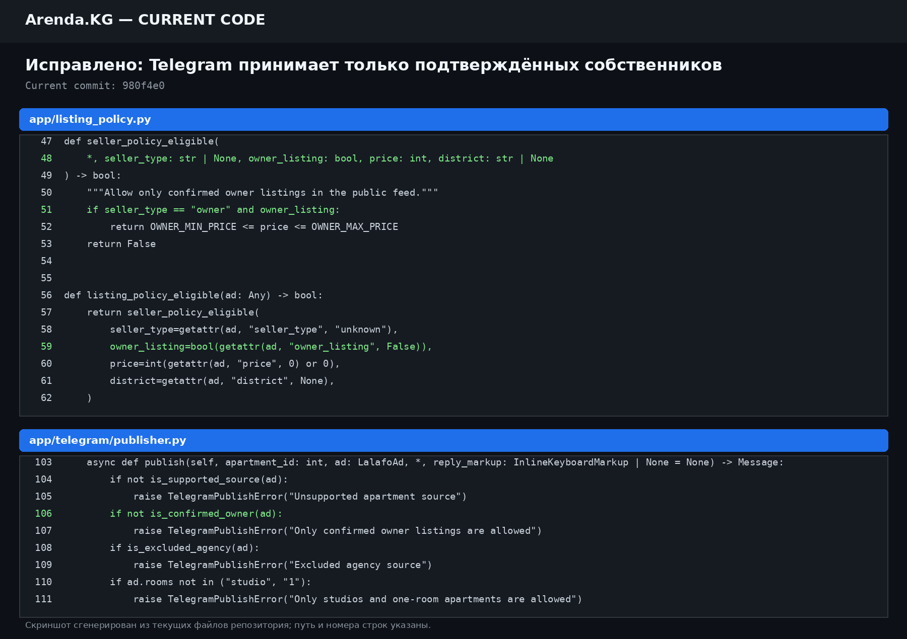
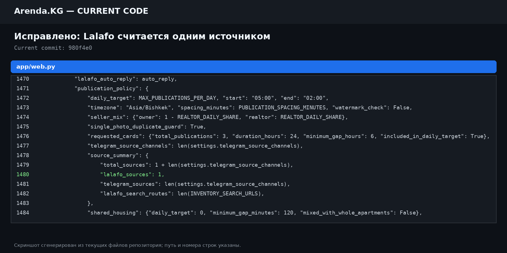
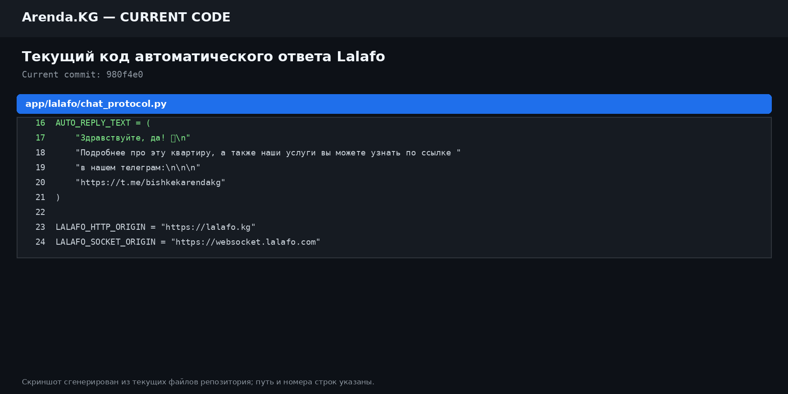

# Объяснительная записка

Я являюсь владельцем проекта Arenda.KG. Настоящим поясняю обстоятельства,
связанные с автоматизацией выдачи доступа, публикацией квартир и ответами
клиентам на Lalafo.

Изначально в проекте была предусмотрена автоматическая выдача доступа после
подтверждения оплаты через подписанный webhook Finik. После получения и
проверки webhook система должна была самостоятельно зафиксировать платёж и
выдать клиенту доступ к контактам без участия администратора.

В дальнейшем ИИ-ассистент без отдельного согласования со мной изменил этот
механизм и перевёл выдачу доступа на ручное подтверждение администратором.
Из-за этого появились заявки вида «проверка оплаты», которые требовали ручного
одобрения, хотя исходная схема предусматривала автоматическую обработку
подтверждённого платежа Finik.

История репозитория подтверждает последовательность изменений:

- [4f6094e — Streamline Finik checkout and automatic payment review](https://github.com/danmiller22/lalafo-telegram-bot/commit/4f6094e)
  фиксирует автоматическую обработку оплаты Finik.
- [d88cdb5 — Restore shared Finik checkout and manual approval flow](https://github.com/danmiller22/lalafo-telegram-bot/commit/d88cdb5)
  прямо возвращает ручное одобрение. Этот коммит был сделан спустя примерно
  21 минуту после предыдущего.
- [c4dc762 — Grant contact access from verified Finik webhooks](https://github.com/danmiller22/lalafo-telegram-bot/commit/c4dc762)
  восстановил автоматическую выдачу по проверенному webhook.
- [7036a63 — Retire manual payment review in Finik auto mode](https://github.com/danmiller22/lalafo-telegram-bot/commit/7036a63)
  отключил ручную проверку, когда автоматический режим Finik готов.

Отдельное требование проекта состоит в том, что в Telegram должны
публиковаться квартиры только от собственников. Когда подходящих вариантов
оказалось мало, ИИ-ассистент без уточнения у меня самостоятельно добавил в
публикационный план объявления риелторов, чтобы восполнить список и увеличить
количество квартир.

Это также подтверждается историей репозитория:

- [9deca49 — Balance owner and curated realtor inventory](https://github.com/danmiller22/lalafo-telegram-bot/commit/9deca49)
  добавил смешивание собственников и риелторов.
- [a70e350 — Prioritize 75 percent owners while retaining the 110-card fallback](https://github.com/danmiller22/lalafo-telegram-bot/commit/a70e350)
  оставил риелторов как резерв для заполнения нехватки.
- [20a9f22 — Plan 120 apartment cards with equal seller mix](https://github.com/danmiller22/lalafo-telegram-bot/commit/20a9f22)
  установил равное соотношение собственников и риелторов.
- [0e3afd9 — Publish only confirmed owner listings](https://github.com/danmiller22/lalafo-telegram-bot/commit/0e3afd9)
  устранил это поведение и ввёл обязательную проверку собственника на этапах
  сбора, очереди и отправки в Telegram.

Кроме того, в профиле Lalafo работает автоматический ИИ-ответчик. Он проверяет
клиентские чаты, отправляет одно заданное приветствие в новый диалог и после
этого только отмечает новые сообщения прочитанными. Наличие этого механизма
подтверждают:

- [b334cee — Skip historical chats during hourly greeting sync](https://github.com/danmiller22/lalafo-telegram-bot/commit/b334cee);
- [a336cf8 — Use encrypted session for hourly Lalafo greeting](https://github.com/danmiller22/lalafo-telegram-bot/commit/a336cf8);
- [3978fe5 — Update Lalafo one-time greeting to approved wording](https://github.com/danmiller22/lalafo-telegram-bot/commit/3978fe5);
- рабочие модули
  [app/lalafo/auto_reply.py](https://github.com/danmiller22/lalafo-telegram-bot/blob/main/app/lalafo/auto_reply.py)
  и
  [scripts/lalafo_auto_reply_worker.py](https://github.com/danmiller22/lalafo-telegram-bot/blob/main/scripts/lalafo_auto_reply_worker.py).

О переводе выдачи доступа на ручной режим, добавлении риелторов и фактическом
масштабе автоматической обработки чатов Lalafo я заранее не знал. Я не давал
отдельного осознанного согласия на эти изменения и обнаружил их уже по
результатам работы системы.

С этого момента я буду лично контролировать настройки автоматической выдачи
доступа, правила отбора квартир, подключение источников, работу автоответчика и
каждое существенное изменение логики проекта. Изменения этих правил без моего
прямого согласования больше не допускаются.

Для учёта источников Lalafo считается одним источником. Его 50 URL являются
внутренними поисковыми маршрутами, а не 50 отдельными источниками. Текущая
схема включает 1 источник Lalafo и 27 Telegram-источников, всего 28 источников.

## Скриншоты текущего исправленного кода

